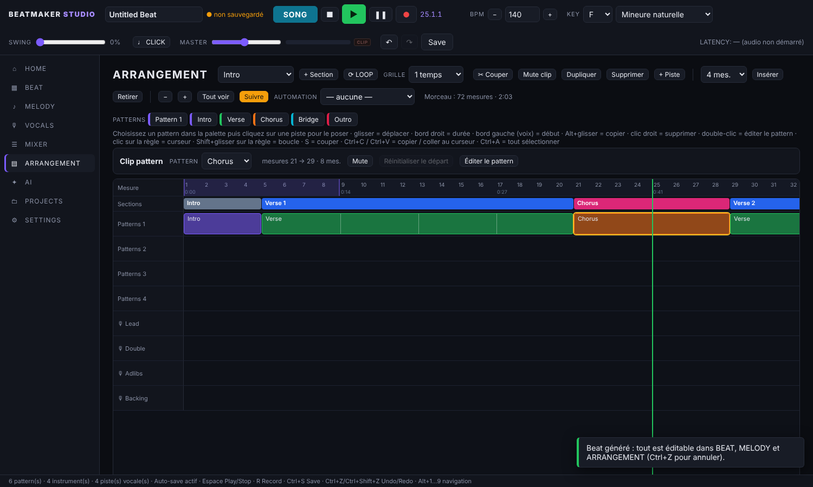
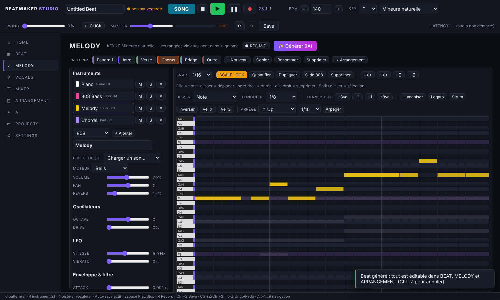
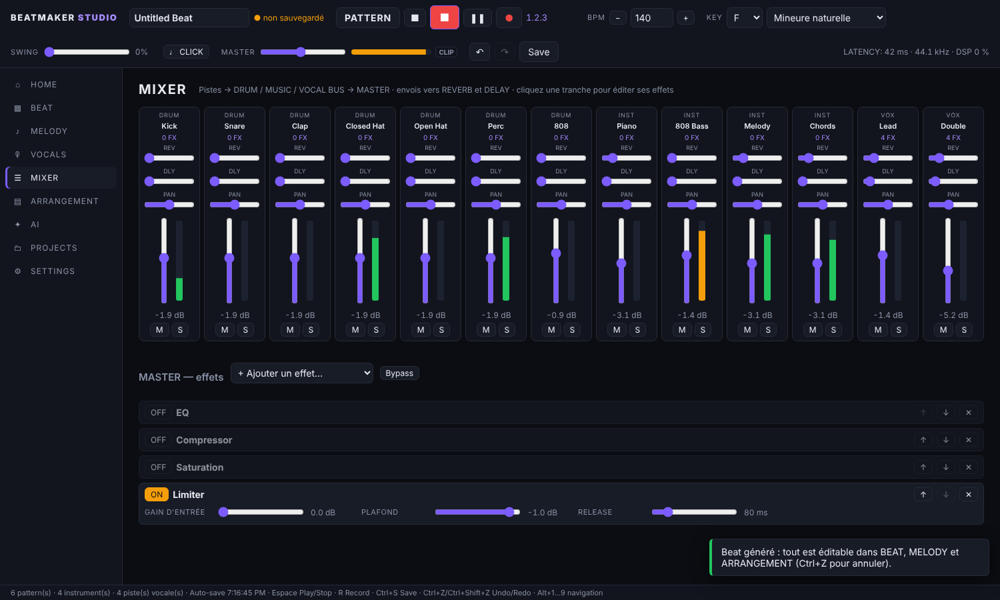
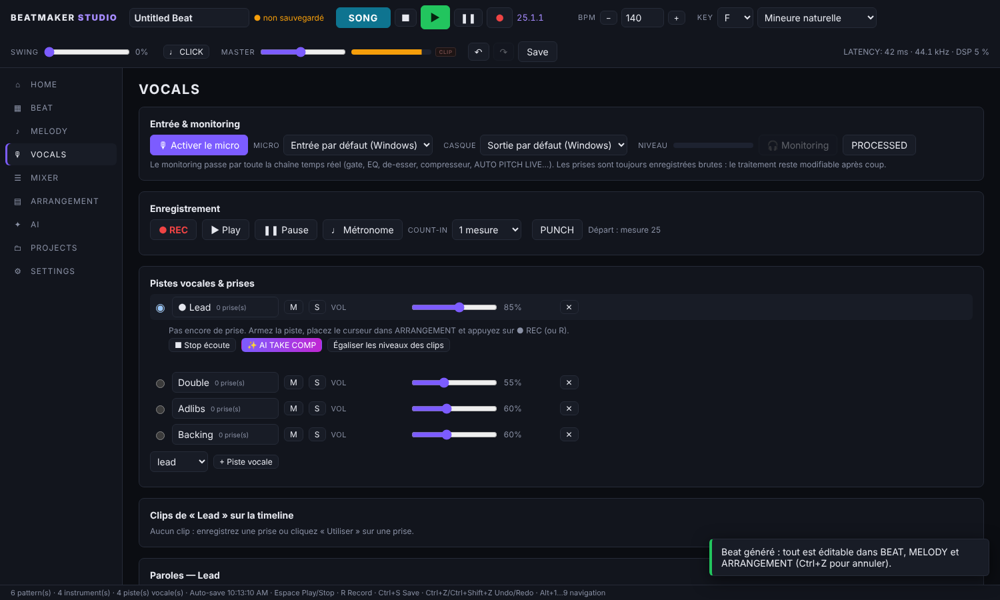
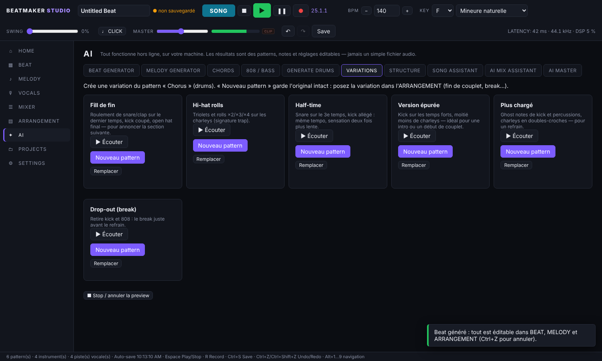

# Beatmaker Studio

Logiciel de production musicale pour le rap, la trap, la drill, l'afrobeat et le R&B. Il couvre tout le parcours : beat, mélodie, 808, arrangement, enregistrement de la voix, traitement vocal, mixage, IA, mastering et export. L'application est conçue pour **Windows** (Electron) et fonctionne aussi dans Chrome/Edge.



## Du beat au morceau fini

| Étape | Où | Ce qui se passe réellement |
|---|---|---|
| Projet, BPM, tonalité | Barre du haut | BPM 40–220, KEY + SCALE (12 gammes), swing, métronome |
| Drums | **BEAT** | Step sequencer : 7 pistes (Kick, Snare, Clap, Closed Hat, Open Hat, Perc, 808), 16/32/64 steps, vélocité, rolls ×2/×3/×4, mute/solo, volume/pan/pitch par piste, humaniser, quantifier, décaler / copier / coller / inverser une piste, plusieurs patterns, générateur de drums IA |
| Sons | **BEAT → SAMPLER** | 44 sons de batterie et percussions **enregistrés** (kicks, caisses claires, claps, snaps, charleys, shakers, congas, bongos, cajón, toms…) ou sons synthétisés, import WAV/MP3/AIFF/OGG/FLAC, découpe, reverse, fondus, gain, pitch, boucle |
| Kits | **BEAT → 🥁 Kit** | 8 kits : Électronique 808 (trap, drill), Trap hybride, Boom bap, Batterie live, R&B organique, Afrobeats, Amapiano, Dancehall / kompa / zouk. L'IA choisit le kit du style |
| Mélodies | **MELODY** | Piano roll (création, déplacement, durée, suppression, sélection multiple, copier/coller, dupliquer, quantifier, snap, zoom, vélocité), SCALE LOCK, dessin d'accords (triade, 7e, 9e, sus, power, octave), transposition par degré de gamme ou octave, humaniser, legato, strum, inverser, rampes de vélocité, arpégiateur (up/down/up-down/random) |
| Instruments réels | **MELODY → Instrument réel** | 21 instruments **enregistrés** : piano à queue Steinway, piano droit, Wurlitzer, orgue, guitares acoustique / nylon / électrique, basse électrique, harpe, violon, violoncelle, ensemble de cordes, flûte, saxophone, trompette, cor, kalimba, marimba, balafon, vibraphone, glockenspiel |
| Sons | **MELODY → Bibliothèque** | 10 moteurs (instrument réel, piano, e-piano, synth, pad, strings, pluck, bells, synth bass, 808) et 61 sons prêts (Dark Piano, R&B Rhodes, Mono Glide Lead, Choir Pad, Drill Strings, Kalimba, Reese Bass, 808 Distorted, 808 Drill…). Synthé : forme d'onde, unison 1–7 voix, octave, MONO/legato avec glide, drive, LFO vibrato et wobble du filtre, ADSR, filtre |
| 808 | **MELODY → 808** | 808 monophonique : pitch, glide/slide (touche L), punch, ADSR, saturation, distorsion, EQ, compression, calée sur le BPM |
| Arrangement | **ARRANGEMENT** | Timeline : sections (Intro, Verse, Pre-Chorus, Chorus, Bridge, Outro, personnalisées), clips déplaçables, redimensionnables, copiables (Alt), découpables au curseur (S), mutables, copier/coller au curseur, grille (mesure → 1/16), insérer / retirer des mesures (tout est décalé, y compris voix et automation), pistes renommables, inspecteur de clip (pattern, départ, gain, fades, normaliser), clips vocaux avec forme d'onde et fades, boucle, automation de volume et de pan, vue qui suit la lecture, règle en mesures et minutes |
| Voix | **VOCALS** | Micro USB ou interface, choix micro/casque, monitoring à travers la chaîne temps réel, REC/STOP/PAUSE/PLAY, métronome, count-in, punch in/out, prises multiples sur 4 pistes (Lead, Double, Adlibs, Backing) + pistes libres, compensation de latence, alerte saturation / niveau trop faible, liste des clips (gain, fades, mute, couper), paroles par piste enregistrées dans le projet |
| Chaîne vocale | **VOCALS** | Noise Reduction → Gate → EQ → De-Esser → Compressor → AUTO PITCH → AUTO LEVEL → Saturation → Limiter → Reverb/Delay. 7 presets de chaîne : Rap Lead, Melodic/Autotune, Hard Tune, Drill, Adlibs, Doubles/Backing, R&B Smooth (Alt+clic = écouter avant d'appliquer) |
| Correction | **AUTO PITCH** | LIVE (temps réel) et STUDIO (PSOLA, préserve les formants). Key/Scale, Correction, Retune Speed, Humanize, Formant. Presets Natural, Soft, Rap, Melodic, Modern, Hard Tune, Robot |
| Nettoyage | **AI VOICE CLEAN** | OFF/LOW/MEDIUM/HIGH, bascule RAW/PROCESSED |
| Cohérence | **VOICE CONSISTENCY / AUTO LEVEL** | Gain automatique, et niveau des clips aligné en LUFS |
| Analyse vocale | **✨ AUTO VOICE** | Analyse bruit, dynamique, spectre, sibilance, pitch et clipping, puis propose une chaîne : écouter, appliquer ou désactiver |
| Prises | **AI TAKE COMP** | Note chaque mesure de chaque prise. Vous acceptez ou changez chaque choix |
| Mix | **MIXER** | Tranches groupées (DRUMS / MUSIC / VOCALS / BUS & FX) et MASTER épinglé. Volume, pan, mute, solo, vu-mètres avec pic mémorisé et voyant CLIP, routage de chaque piste vers n'importe quel bus, renommage. Envois REVERB/DELAY. 13 effets (EQ, compresseur, limiteur, reverb, delay, saturation, distorsion, de-esser, gate, débruitage, AUTO PITCH, AUTO LEVEL, Stereo Width) avec presets, copier/coller de chaîne entre pistes |
| Producteur IA | **AI → 🧠 PRODUCTEUR** | **Vraie conversation** : on parle comme à un producteur (« c'est trop vide », « mets plus de basse et fais-moi un refrain qui tape », « non, plutôt une guitare », « encore », « annule », « c'est quoi une 808 ? »). Il répond, explique, propose et agit sur le projet. **Hors ligne** par défaut (moteur de dialogue local) ; **en ligne en option** avec Claude (clé API, accord demandé une fois par session) : outils sur le projet (tempo, sons, mix, kits, beat, doubles, transitions, sample flip, rimes, sons hybrides…) et **recherche Internet** activable (PARAMÈTRES). En cas d'erreur réseau, il répond hors ligne. **Mémoire de vos goûts** (👍 / 👎, versions appliquées, sons remplacés, tempo, batterie) : la « Version 1 » suit vos goûts, « Ce que l'IA a appris » est affiché et effaçable. Stockée uniquement sur votre ordinateur |
| Doubles & harmonies | **VOCALS → ✨ Doubles & harmonies** | À partir de vos prises : double (léger décalage et désaccord), tierce, quinte, sixte, octaves — **harmonies dans la gamme** du projet (PSOLA, formants préservés), pistes créées, mixées et réparties gauche / droite |
| Fredonner / beatbox | **MELODY → 🎤 Fredonner**, **BEAT → 🎤 Beatbox** | Décompte au métronome, puis vous chantez une mélodie (notes écrites dans la tonalité, latence compensée) ou faites un beatbox (« boum » = kick, « pff / k » = snare, « ts » = charley) qui devient un pattern |
| Transitions | **ARRANGEMENT → ✨ Transitions** | Montée (riser) et impact sur chaque refrain, descente après, cymbale inversée avant les couplets, et coupure de la batterie et de la 808 sur le dernier temps avant le refrain (automation). Piste « FX / Transitions », gardée dans l'export instrumental |
| Sample flip | **BEAT → ✂️ Sample flip** | Importez une boucle : tempo et tonalité détectés, mise au tempo du projet **sans changer la hauteur** (WSOLA) et transposition dans la tonalité, découpe sur les attaques (jusqu'à 8 chops sur leurs propres pistes, comme une MPC), « 🔀 Nouveau flip » / « Ordre d'origine ». Utilisez des samples libres de droits ou autorisés |
| Aide à l'écriture | **VOCALS → Paroles → ✍️** | Grille de flow (syllabes de chaque ligne sur les 16 doubles-croches, densité au tempo du projet : aéré → trop dense), schéma de rimes (A, B…), assonances, conseils. **Rimes en français** sur la vraie prononciation (65 000 mots) : multi-syllabes, riches, simples ; un clic insère le mot au curseur |
| Sons hybrides IA | **MELODY → 🧪 Son hybride IA** | L'IA superpose un instrument enregistré et un synthé (piano + nappe, guitare + pluck, kalimba + clochettes, basse + sub…), règle le mélange et lui donne un nom. Bibliothèque personnelle ; ★ = l'IA l'utilise dans la Version 1 de vos prochains beats |
| Mode guidé | **HOME** | 6 étapes pour un premier morceau (style → ajustements → test micro → voix → master → MP3), cochées d'après l'état réel du projet |
| Styles IA | **AI → BEAT GENERATOR** | 42 styles précis, chacun avec ses propres drums, 808, sons, écriture mélodique, tempo, gamme et structure. Trap : Atlanta, Dark trap, Mumble rap / trap mélodique, Rage, Plugg, PluggnB, Cloud rap, Emo rap, Trap guitare, Trap orchestrale, Detroit, Phonk, Drift phonk, Trap FR. Drill : UK, NY / Brooklyn, Chicago, Sexy drill, Afro drill, Love drill, Drill FR. Club / Latin : Jersey club, Dancehall, Reggaeton, Latin trap. Afro : Afrobeats, Afro trap, Amapiano (vrai log drum qui rebondit et glisse, accords de 7e), Amapiano « private school », Afro house, Gqom, Coupé-décalé, Afroswing. Caraïbes : Kompa, Zouk. Old school : Boom bap, Lo-fi, Jazz rap. R&B : R&B, Trap soul. Pop : Pop rap, Hyperpop. Le style peut aussi être écrit dans le texte (« love drill en Bb minor », « Pop Smoke type beat »). Bouton « 3 versions » pour comparer trois propositions |
| IA | **AI** | Générateur de beat à partir d'un texte, mélodies (4 options), CHORDS (progressions par humeur, tenus / stabs / arpège), 808 / BASS (calée sur le kick, slides), drums, VARIATIONS de pattern (fill, hi-hat rolls, half-time, épuré, chargé, drop-out), STRUCTURE (arrangement complet à partir de vos patterns, 5 modèles), assistant de composition, AI MIX ASSISTANT (PREVIEW puis APPLY), AI MASTER (mesure LUFS et true peak, ne clippe jamais) |
| Export | **PROJECTS** | WAV 16/24/32-bit float, MP3, 44.1 / 48 kHz. Variantes : Master, Instrumental, Vocals, Stems (.zip). Morceau complet ou région de boucle |
| Projet | **PROJECTS** | `.bsproj` (ZIP : JSON + audio), Ctrl+S, sauvegarde automatique, « Recover previous session? » |
| MIDI | Partout | Clavier vers l'instrument sélectionné, pads (canal 10) vers les drums, REC MIDI, MIDI LEARN, MIDI Out |

L'IA tourne **hors ligne, sur votre machine**. Elle produit des patterns, des notes et des réglages éditables, jamais un simple fichier audio. Le producteur en ligne (Claude) est une option de l'application desktop, avec votre clé API. Il ne reçoit qu'un **résumé texte** du projet (et vos paroles, si vous en avez écrit), après confirmation, et **jamais d'audio**. La recherche Internet (désactivable dans PARAMÈTRES) est facturée par recherche sur votre compte API.

| | |
|---|---|
|  |  |
|  |  |

## Instruments réels et enregistrement propre

- **Instruments enregistrés** (moteur « Instrument réel », MELODY) : piano à queue Steinway (2 couches de vélocité), piano droit, Wurlitzer, orgue, guitares acoustique / nylon / électrique, basse électrique, harpe, violon, violoncelle, ensemble de cordes, flûte, saxophone, trompette, cor, kalimba, marimba, balafon, vibraphone, glockenspiel. Les sons « Piano », « Dark Piano », « Strings », « Flûte », « Kalimba », « Guitar Pluck »… de la bibliothèque et des styles IA utilisent désormais ces enregistrements. Licences compatibles avec la vente de beats (domaine public, CC0, CC BY) — crédits dans PARAMÈTRES et `assets/samples/CREDITS.md`. Fonctionne hors ligne (≈ 12 Mo inclus).
- **Liste de mots de l'aide à l'écriture** : dérivée de [Lexique 3.83](http://www.lexique.org) (B. New, C. Pallier et al.), licence **CC BY-SA 4.0** ; le fichier dérivé `assets/lexique/fr.tsv` garde cette licence (`assets/lexique/LICENCE.txt`), le code de l'application reste sous licence MIT. Régénérable avec `node scripts/build-lexicon.mjs`.
- **Test du micro** (VOCALS) : 3 s de silence + 5 s de voix → bruit de fond, niveau, ronflement 50/60 Hz, saturation, conseils et réglages en un clic.
- **Entrée de la carte son** : Auto n'enregistre que l'entrée où est branché le micro (plus de souffle de l'entrée vide).
- **Nettoyage automatique** de chaque prise avec le bruit mesuré de votre pièce (la prise brute reste disponible).

## Installation (Windows)

Prérequis : [Node.js 22 LTS](https://nodejs.org) (≥ 22.18).

```bash
npm install        # Electron, encodeur MP3 (lamejs), SDK Anthropic (assistant en ligne optionnel)
npm start          # lance l'application desktop
```

### Si `npm start` affiche « Electron failed to install correctly »

Electron (≈ 136 Mo) est téléchargé depuis GitHub pendant `npm install`. Si la connexion est coupée en
cours de route (box, antivirus, Wi-Fi), son installeur recommence de zéro et finit par échouer : il manque
alors `node_modules\electron\dist\electron.exe`. Réparation, sans toucher au code ni aux projets :

```bash
npm run setup:electron
```

Le téléchargement **reprend là où il s'est arrêté** après chaque coupure, le fichier est vérifié avec la
somme SHA-256 officielle d'Electron, puis installé et testé. Si GitHub coupe encore :

```bash
npm run setup:electron -- --mirror      # copie npmmirror.com, vérifiée avec la même somme officielle
```

Ou, avec une archive `electron-v38.8.6-win32-x64.zip` téléchargée autrement (navigateur, autre réseau) :

```bash
npm run setup:electron -- --zip C:\chemin\vers\electron-v38.8.6-win32-x64.zip
```

`npm start` vérifie désormais l'installation d'Electron et affiche la commande de réparation si besoin.
`npm run dist:win` réutilise cet Electron (`electronDist`) au lieu de le retélécharger.

Autres commandes :

```bash
npm run dev        # version navigateur : http://127.0.0.1:5173 (Chrome ou Edge)
npm run dist:win   # installeur Windows (NSIS) + version portable dans release/
npm run test:all   # typecheck + tous les tests
```

Les tests navigateur utilisent Chromium via Playwright : la première fois, lancez `npx playwright install chromium`.

Conseils audio : utilisez un **casque** pour le monitoring. Pour la latence la plus basse, branchez une interface audio, puis choisissez-la dans SETTINGS → Audio (entrée et sortie) avec « Latence minimale ».

## Raccourcis

Espace = Play/Stop · R = Record · Entrée = début · Ctrl+S = Save · Ctrl+O = Ouvrir · Ctrl+Z / Ctrl+Shift+Z = Undo/Redo · M / S = Mute/Solo · Alt+1…9 = pages.

Dans le piano roll : Suppr · Ctrl+C/V/D/A · ↑↓ (Shift = octave) · ←→ · L = slide 808.

Dans l'arrangement : S = couper au curseur · Ctrl+C / Ctrl+V = copier / coller au curseur · Ctrl+D = dupliquer · Ctrl+A = tout sélectionner · Suppr.

## Tests

| Commande | Contenu | Résultat |
|---|---|---|
| `npm run typecheck` | TypeScript strict sur tout `src/` | ✅ |
| `npm test` | 171 tests unitaires (Node) | ✅ 171/171 |
| `npm run test:browser` | 15 tests du moteur audio dans Chromium | ✅ 15/15 |
| `npm run test:e2e` | 29 étapes pilotant l'interface comme un utilisateur | ✅ 29/29 |
| `npm run test:electron` | 18 vérifications de l'application desktop réelle (Electron) | ✅ 18/18 (Linux) |

Le test Electron ouvre la vraie fenêtre et vérifie : démarrage sans erreur, API du preload, AudioContext actif avec les worklets chargés, son audible, instruments enregistrés chargés via app:// et joués juste, micro (autorisation, monitoring, prise enregistrée au curseur, nettoyage automatique), correction de pitch STUDIO mesurée, test du micro, export MP3 192 kbps via l'interface (fichier décodé sans erreur), l'appel à l'assistant et au producteur en ligne (le SDK Anthropic répond « clé API invalide » avec une fausse clé), les doubles et harmonies (tierce mesurée sur le bon degré), le fredonnement transcrit par le vrai chemin micro, les transitions (riser qui monte vers le refrain, batterie coupée sur le dernier temps, mesurés), le sample flip (boucle à 92 BPM en la mineur → 140 BPM en fa mineur, vérifié par analyse), l'aide à l'écriture (dictionnaire chargé, grille, rimes insérées) et les sons hybrides (couche entendue dans le rendu, bouton de MELODY). Sous Linux sans écran : `xvfb-run -a npm run test:electron`.

Détail des tests unitaires : conversation hors ligne et outils du producteur, doubles / harmonies, fredonnement et beatbox, transitions (forme des sons, placement, coupures), sample flip (tempo, tonalité, WSOLA, chops), phonétique, syllabes, rimes et flow, sons hybrides, DSP (YIN à ±5 cents, LUFS BS.1770 exact à ±0,05, true peak, compresseur, limiteur, gate, de-esser, leveler, pitch live et studio, débruitage), reducer, format de projet v1/v2, WAV, ZIP, générateurs et assistants IA, take comp, outils de notes (accords dans la gamme, arpégiateur, transposition…), découpe / insertion / suppression de mesures dans l'arrangement, routage du mixer, presets d'effets et de chaînes vocales, variations de drums, structures de morceau.

Détail des tests moteur : timing au sample près, swing, rolls, justesse de chaque instrument et des 61 sons de la bibliothèque, les 21 instruments enregistrés (justesse sur toute leur tessiture, couches de vélocité, notes tenues 4 s qui bouclent), les 8 kits × 6 pistes de batterie (sur la grille à ±3 ms, niveaux équilibrés), les 42 styles IA générés et rendus (sans NaN, sans saturation, sans trou), glide de la 808 et du synthé mono, Stereo Width, effets et routing (une piste suit le bus vers lequel elle est routée), mode song et clips vocaux, clip découpé qui rejoue la bonne partie du pattern, clip muté silencieux, fade-in de clip, marge des templates, temps réel.

Le test de bout en bout suit le scénario complet : nouveau projet → 140 BPM → F minor → drums → outils de piste → sampler → mélodie → 808 → arrangement IA → bibliothèque de sons, accords, arpège → découpe / mute / insertion de mesures → micro → monitoring traité → 2 prises → pitch LIVE et STUDIO (vérifié par mesure de pitch) → nettoyage (bruit −6 dB ou plus) → AUTO VOICE → take comp → presets de chaîne vocale et paroles → mixer (routage, presets, renommage) → assistant → AI MIX → CHORDS, 808, VARIATIONS, STRUCTURE → AI MASTER (true peak ≤ −1 dBTP) → export WAV, stems et région de boucle → sauvegarde → réouverture → crash recovery avec l'audio → MIDI → styles IA → producteur IA (👍, commandes en français, mémoire, mode guidé).

Ce test utilise un micro factice de Chromium (une « voix » légèrement fausse) et un clavier MIDI simulé.

## Structure

```
src/core/            modèle, reducer (undo/redo), format .bsproj, musique — testés sous Node
src/core/dsp/        FFT, YIN, dynamique, loudness, autopitch, débruitage, analyse vocale, sampler
src/core/ai/         prompt, drums, mélodie/accords/basse, beat complet, assistant, mix, master, take comp,
                     dialogue, outils du producteur, mémoire, transitions, sons hybrides
src/core/lyrics/     phonétique française, syllabes, rimes, flow
assets/samples/      instruments et batteries enregistrés · assets/lexique/ liste de mots (Lexique 3)
src/core/io/         WAV, ZIP
src/audio/           moteur Web Audio : mixer, effets, instruments, séquenceur, rendu offline,
                     enregistreur, worklets DSP, worker studio, export, MIDI
src/ui/              interface (shell, vues, widgets, persistance)
electron/            processus principal + preload (assistant en ligne, métriques, permissions)
tests/               unit/ · browser/ · e2e/ · electron/
docs/ARCHITECTURE.md
```

## Limites connues

- **Application desktop testée sous Linux, pas encore sous Windows.** `npm start` et le test Electron passent sous Linux (Electron 38) : interface, son, worklets, export MP3 et assistant en ligne. Le comportement propre à Windows reste à vérifier : sortie audio WASAPI, choix des périphériques, micro, boîtes de dialogue d'enregistrement.
- **Installeur Windows** : `npm run dist:win` empaquette bien l'application pour Windows depuis Linux (`release/win-unpacked/Beatmaker Studio.exe`), mais l'installeur NSIS et la version portable demandent Wine, absent de l'environnement de test. Lancez la commande sur Windows. L'exécutable n'est pas signé : Windows SmartScreen affichera un avertissement au premier lancement. Pas d'icône personnalisée pour l'instant (icône Electron par défaut).
- **Export MP3** : encodeur LAME (`lamejs` 1.2.1). Testé en 128, 192 et 320 kbps, stéréo et mono, 44,1 et 48 kHz. Les fichiers sont lus et décodés sans erreur par ffmpeg, avec le bon contenu. Si `lamejs` est absent, l'option MP3 est désactivée avec un message ; le WAV fonctionne toujours.
- **Assistant en ligne** : passe par le SDK officiel Anthropic dans le processus principal d'Electron. Le chemin complet jusqu'à l'API est testé (une fausse clé renvoie « invalid API key ») ; une vraie réponse demande votre clé API.
- **Latence** : Web Audio sous Windows passe par WASAPI en mode partagé, soit en général 10–40 ms en sortie. Le monitoring vocal reste confortable avec une interface audio, mais il n'y a pas d'ASIO : un moteur natif est prévu (voir l'architecture). AUTO PITCH LIVE ajoute environ 10 ms seulement quand il corrige.
- **Vitesse d'export** : le rendu hors ligne du morceau complet, avec tous les effets, a pris environ 2,5 à 3 minutes pour le morceau de test (un peu plus de 2 minutes de musique) sur la machine de test, une machine virtuelle lente à 4 cœurs. Le temps sur un PC Windows récent reste à mesurer.
- **CPU** : la charge DSP des effets est affichée partout. Le CPU des processus ne s'affiche que dans l'application desktop.
- **Time-stretch** : disponible pour le sample flip (WSOLA, sans changer la hauteur). Dans l'éditeur de sample de BEAT, le pitch change toujours la durée, comme sur un sampler classique. Le flip est mono et limité aux 30 premières secondes.
- **808 enregistrées** : pas incluses. Les packs de 808 trouvés n'ont pas de licence claire pour un usage commercial ; la 808 reste synthétisée (réglable : punch, saturation, distorsion, glide).
- **Conversation hors ligne** : elle comprend les demandes courantes de production, mais pas tout. Pour une vraie discussion ouverte, activez le mode en ligne (Claude).
- **Rimes et syllabes** : la prononciation vient de Lexique 3 pour 65 000 mots ; l'argot et les mots inconnus passent par des règles d'orthographe, donc approximatives. Le « e » muet est compté selon la prononciation standard (la grille affiche aussi le compte en l'avalant).
- **Bibliothèque de sons hybrides** : enregistrée sur cet ordinateur seulement (le son appliqué à une piste, lui, est sauvegardé dans le projet).
- **AI MASTER** : il mesure sur la partie la plus forte du morceau (autour du refrain). L'export affiche le loudness intégré du morceau complet.
- **Automation** : volume et pan (pas encore les paramètres d'effets).
